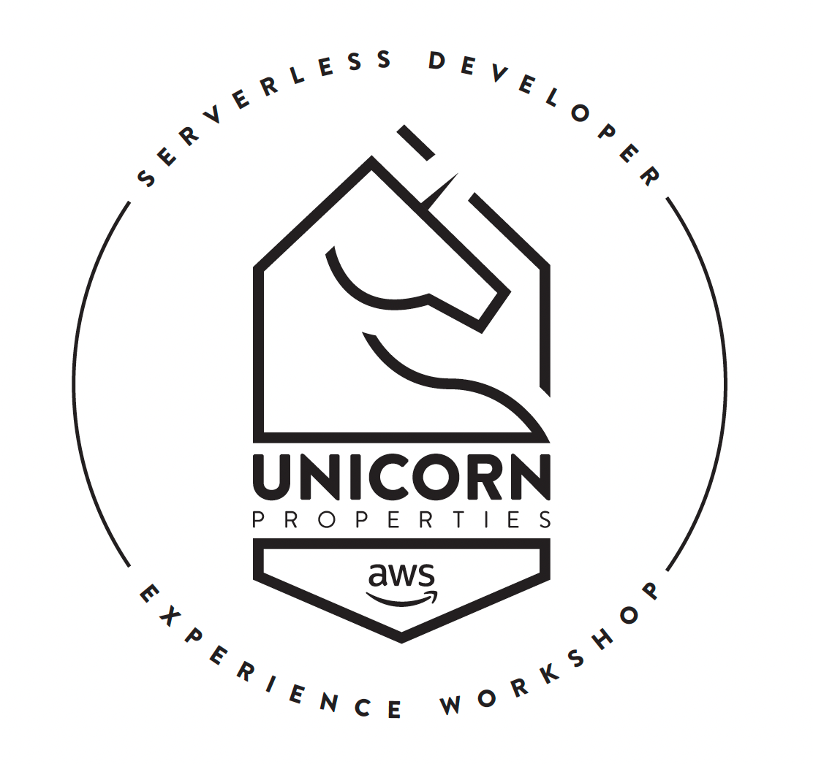
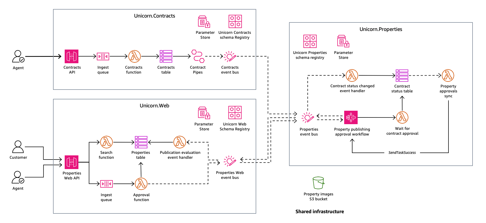

[](https://github.com/aws-samples/aws-serverless-developer-experience-workshop-dotnet/actions/workflows/build.yml)

# AWS Serverless Developer Experience workshop reference architecture (.NET)



This repository contains the .NET 10 reference architecture for the AWS Serverless Developer Experience workshop. Unicorn Properties is a serverless, event-driven real-estate system built from three services:

- [Unicorn Contracts](Unicorn.Contracts/README.md) manages seller contracts and publishes contract status changes.
- [Unicorn Approvals](Unicorn.Approvals/README.md) evaluates listings with an AWS Step Functions workflow.
- [Unicorn Web](Unicorn.Web/README.md) manages property listings, approval requests, and public search.
- [Unicorn Shared](Unicorn.Shared/README.md) owns account/Region and cross-service shared infrastructure.



## Infrastructure ownership

Terraform is the sole deployment and state owner. AWS SAM is limited to build and local testing of Terraform-defined Lambda functions through the native Terraform hook:

```bash
sam build --hook-name terraform
sam local invoke --hook-name terraform <terraform-resource-address> --skip-prepare-infra
```

The service Makefiles set the required Terraform variables and expose these as `make build` and `make local-invoke`. SAM does not own infrastructure state.

## Fifteen independent Terraform roots

Each directory below is an independent root with its own backend key and committed `.terraform.lock.hcl`:

| Owner     | Terraform root                                                                    | Responsibility                                                                            |
| --------- | --------------------------------------------------------------------------------- | ----------------------------------------------------------------------------------------- |
| Contracts | `Unicorn.Contracts/Infrastructure/domain`                                         | Contracts event bus, policies, forwarding role, logging, schema registry, and SSM exports |
| Contracts | `Unicorn.Contracts/Infrastructure/contracts-service`                              | Contracts API, queue, Lambda, DynamoDB, pipe, IAM, and logs                               |
| Contracts | `Unicorn.Contracts/Infrastructure/schema-registry/ContractStatusChanged`          | `ContractStatusChanged` schema                                                            |
| Approvals | `Unicorn.Approvals/Infrastructure/domain`                                         | Approvals event bus, policies, forwarding role, logging, schema registry, and SSM exports |
| Approvals | `Unicorn.Approvals/Infrastructure/approvals-service`                              | Approval Lambdas, DynamoDB, Step Functions, IAM, queues, and logs                         |
| Approvals | `Unicorn.Approvals/Infrastructure/schema-registry/PublicationEvaluationCompleted` | `PublicationEvaluationCompleted` schema                                                   |
| Approvals | `Unicorn.Approvals/Infrastructure/subscriptions/unicorn-contracts`                | Consumer-owned Contracts-to-Approvals forwarding rule                                     |
| Approvals | `Unicorn.Approvals/Infrastructure/subscriptions/unicorn-web`                      | Consumer-owned Web-to-Approvals forwarding rule                                           |
| Web       | `Unicorn.Web/Infrastructure/domain`                                               | Web event bus, policies, forwarding role, logging, schema registry, and SSM exports       |
| Web       | `Unicorn.Web/Infrastructure/web-service`                                          | Web API, Lambdas, DynamoDB, queues, IAM, and logs                                         |
| Web       | `Unicorn.Web/Infrastructure/schema-registry/PublicationApprovalRequested`         | `PublicationApprovalRequested` schema                                                     |
| Web       | `Unicorn.Web/Infrastructure/subscriptions/approvals`                              | Consumer-owned Approvals-to-Web forwarding rule                                           |
| Shared    | `Unicorn.Shared/Infrastructure/api-gateway-account`                               | Sole account/Region owner of API Gateway account logging configuration                    |
| Shared    | `Unicorn.Shared/Infrastructure/namespaces`                                        | Global service namespace SSM parameters                                                   |
| Shared    | `Unicorn.Shared/Infrastructure/uniprop-images`                                    | Stage-scoped shared image bucket and initialization resources                             |

The boundaries are intentional: domain, workload, schema, subscription, and singleton resources have different lifecycles and access responsibilities. Separate state limits blast radius, prevents accidental co-ownership, and lets consuming services own their forwarding rules. Roots integrate through explicit SSM operational contracts rather than Terraform remote-state coupling.

## Operational contracts and order

[`PARITY.md`](PARITY.md) defines the one-way SAM-to-Terraform sync model, participant-visible must-match surfaces, accepted divergences, and the checklist for future mirror updates.

Shared infrastructure publishes the global namespace parameters:

- `/uni-prop/UnicornContractsNamespace`
- `/uni-prop/UnicornApprovalsNamespace`
- `/uni-prop/UnicornWebNamespace`

Each domain publishes stage-scoped `EventBus`, `EventBusArn`, `SchemaRegistryName`, and `EventBridgeRoleArn` parameters under `/uni-prop/${stage}/`. Shared images publishes `/uni-prop/${stage}/ImagesBucket`. These external SSM parameters are intentional runtime and deployment contracts; renaming or removing one is a cross-root breaking change.

Use this dependency order:

1. Bootstrap the versioned remote state bucket once with `make ensure-state-backend` from a service directory. Terraform uses S3-native `.tflock` objects for state locking.
2. Apply Shared API Gateway account logging and namespaces, then the image root for each required stage.
3. Apply Contracts, Approvals, and Web domain roots.
4. Apply each service schema and workload root.
5. Apply subscription roots only after both source and destination domains exist.

Destroy in reverse order. The Shared API Gateway account root is an account/Region singleton and is deliberately excluded from the aggregate Shared delete target.

From the repository root, use the five-phase orchestrator for one stage:

```bash
make deploy-all STAGE=dev
make delete-all STAGE=dev CONFIRM_ACCOUNT_GLOBAL=DESTROY
```

`deploy-all` bootstraps the backend, then applies Shared resources, domains, schemas and services, and subscriptions in order. `delete-all` reverses that order, deletes the account-global namespace parameters used by every stage, and preserves the Shared API Gateway account singleton and state backend. Because namespace removal can affect local, development, and production deployments, `delete-all` requires the independent `CONFIRM_ACCOUNT_GLOBAL=DESTROY` token. Namespace and component targets remain available for narrower changes; direct `Unicorn.Shared delete-namespaces` requires the same token.

## Developer workflow

Service Makefiles provide `init`, `plan`, `deploy`, `build`, `local-invoke`, `test`, `lint`, `clean`, and reverse-order `delete`, plus component-specific variants. Shared provides component-specific `init`, `plan`, `deploy`, `describe`, and delete targets.

```bash
make plan STAGE=local
make deploy STAGE=dev

# Build and invoke a Terraform-defined Lambda locally
make build STAGE=local
make local-invoke STAGE=local
```

Supported stages are `local`, `dev`, and `prod`. For a production root, `make plan STAGE=prod` writes `.terraform/prod.tfplan`. Review that saved plan immediately, then apply that exact plan with `CONFIRM_PROD=APPLY`; production deletion requires `CONFIRM_PROD=DESTROY`. Do not reuse a stale saved plan. The API Gateway account singleton and global namespace root use shared scope rather than a stage; the production saved-plan gate applies to the Shared images root when `stage=prod`. Account-global namespace deletion has its own `CONFIRM_ACCOUNT_GLOBAL=DESTROY` guard.

Lambda archives are produced by [`scripts/package_dotnet_lambda.py`](scripts/package_dotnet_lambda.py), which publishes in Release mode and creates deterministic ZIP files using sorted entries, fixed timestamps, normalized permissions, maximum compression, and atomic replacement. Keep every root's `.terraform.lock.hcl` committed.

The S3 backend uses native lock files and requires Terraform `>= 1.11`. Backend principals need `s3:ListBucket` on the state bucket, `s3:GetObject` and `s3:PutObject` on permitted `.tfstate` objects, and `s3:GetObject`, `s3:PutObject`, and `s3:DeleteObject` on the corresponding `.tfstate.tflock` objects. Self-hosted deployment-runner policies are managed outside this repository and must grant those lock-object actions for their stage-specific keys. The legacy `uni-prop-terraform-locks` DynamoDB table is intentionally retained during the coordinated transition, but this repository no longer creates or uses it. Delete it only after confirming that no operator, branch, or runner still uses DynamoDB locking.

Validate all roots from the repository root:

```bash
python3 scripts/validate_infrastructure.py --checkov
```

The validator checks the exact 15-root inventory, formatting, root validity, provider and lock-file conventions, singleton ownership, SAM metadata parity, production protections, SSM contracts, and PascalCase event schemas. With `--checkov`, it also scans every Terraform root and honors the 21 intentional exceptions documented in `.checkov.yml`. It initializes providers with backends disabled and does not apply infrastructure.
